# holdmybyte

A macOS app that shrinks a wedding photographer's finished JPEGs as far as they go **without visible loss** —
every delivered photo is verified against its original with a perceptual metric (SSIMULACRA2) — and produces the
usual deliveries in one pass: the couple's full-size package (JPEG), a website set (WebP), social/blog images
(JPEG) and a byte-exact archive (lossless JPEG XL). Originals are never modified. Everything stays on the Mac.

The binding specification is [`Docs/SPEC.md`](Docs/SPEC.md).

## Screenshots

Rendered offscreen by `hmb-snapshot` with synthetic thumbnails (no client photos; the design review is
[`Docs/REVIEW.md`](Docs/REVIEW.md), every state is in [`Docs/SNAPSHOTS.md`](Docs/SNAPSHOTS.md)). Glass is drawn as a
flat stand-in offscreen.

| Light | Dark |
|---|---|
| 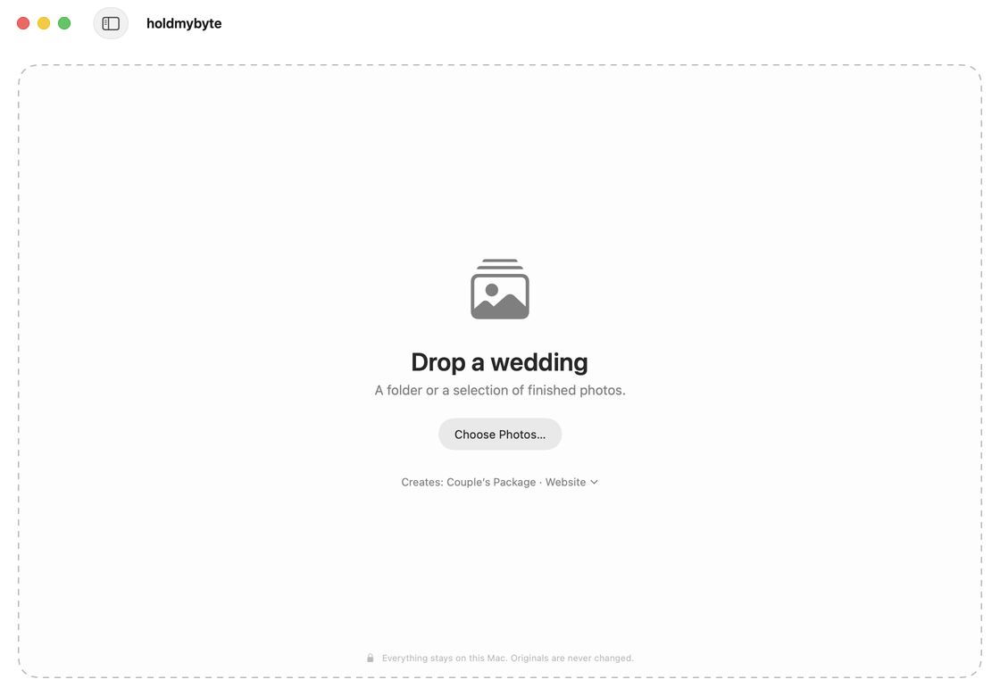 | 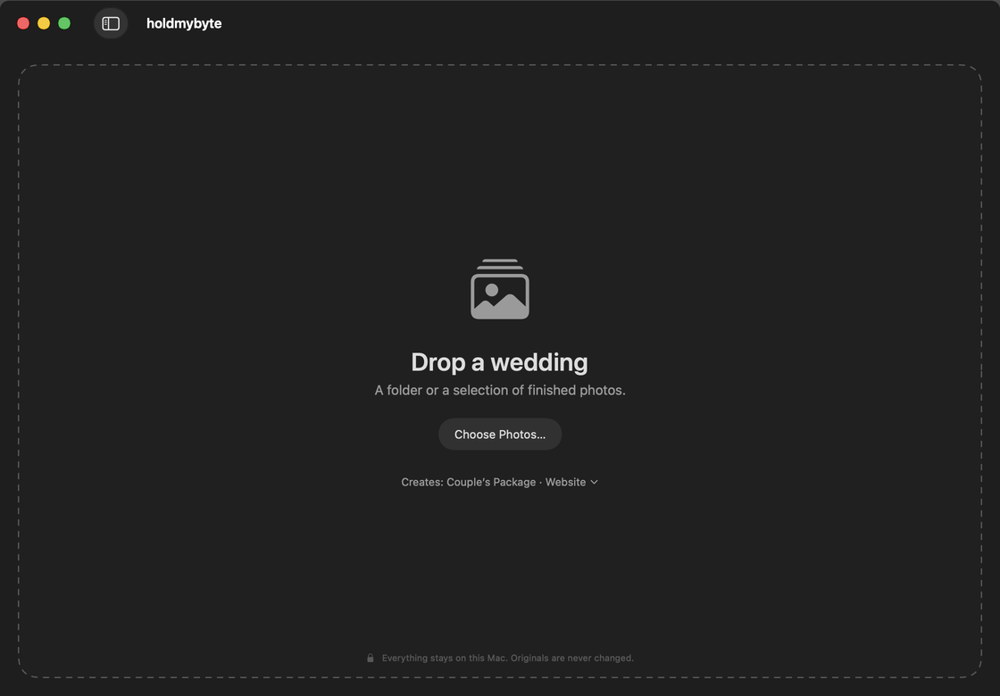 |
| 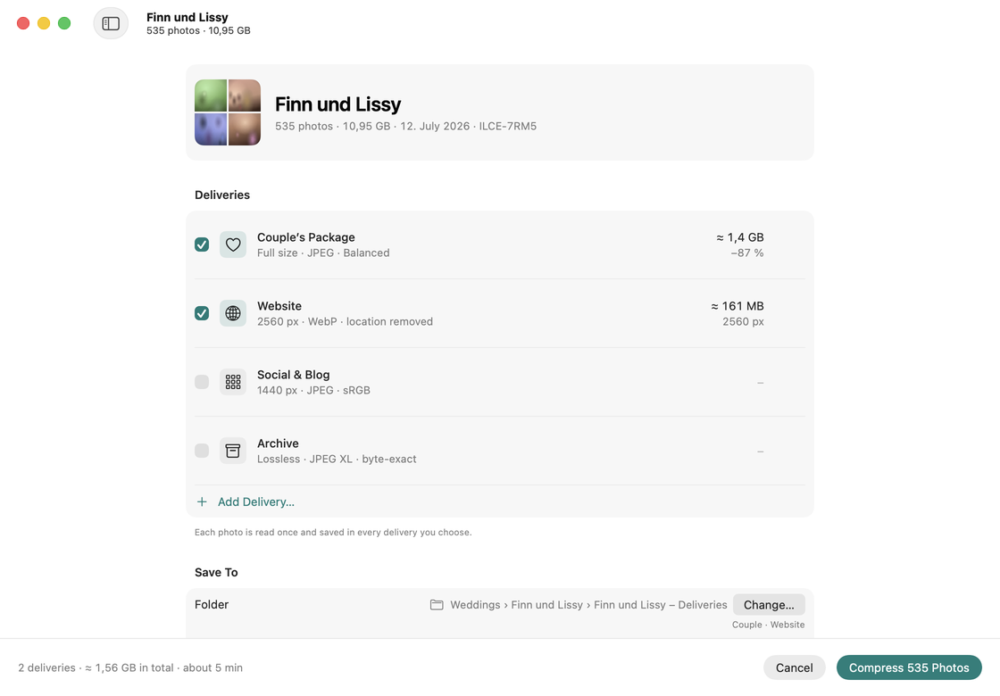 | 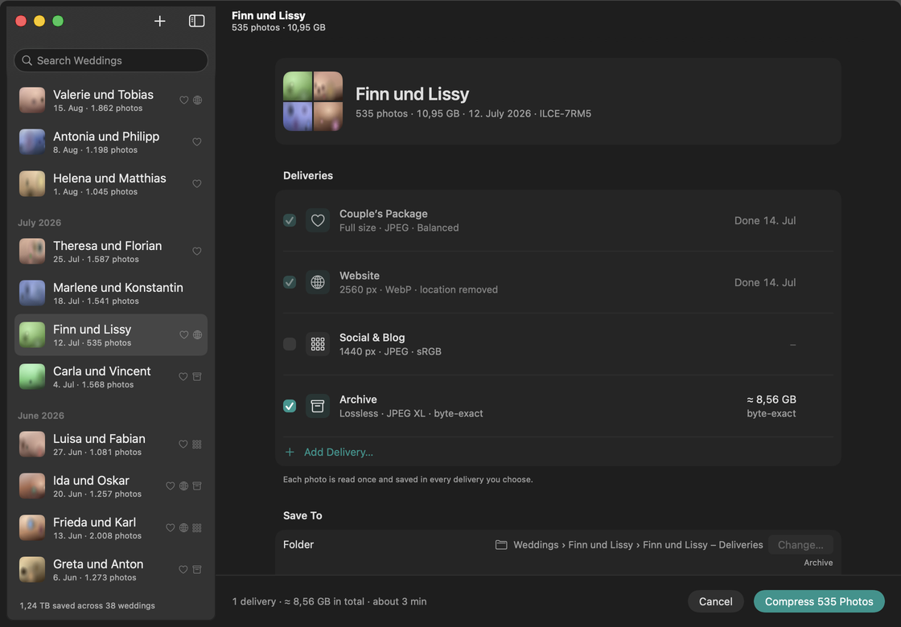 |
| 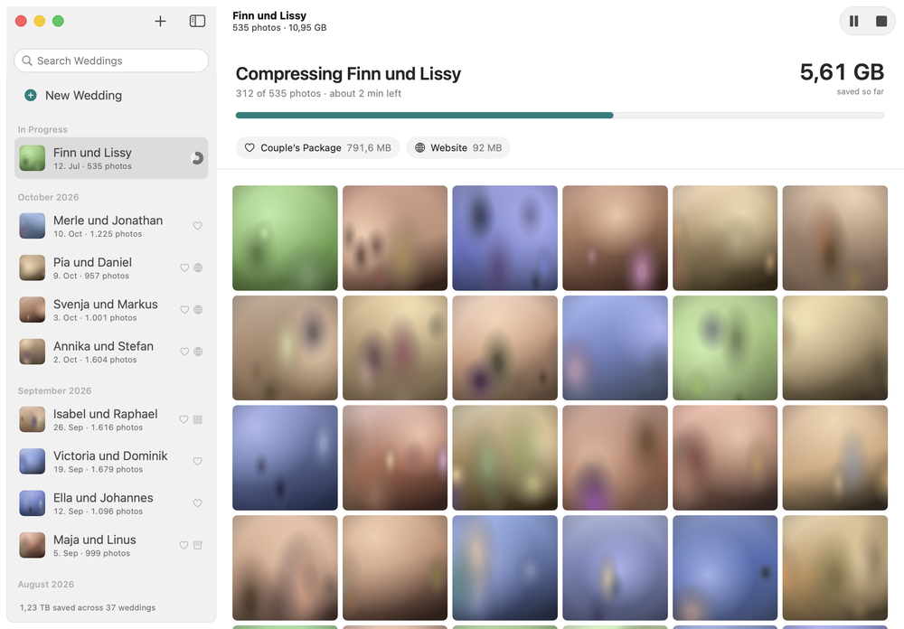 | 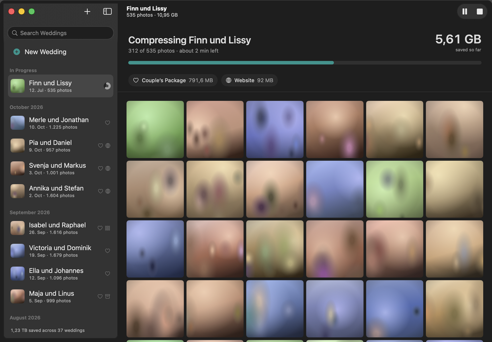 |
| 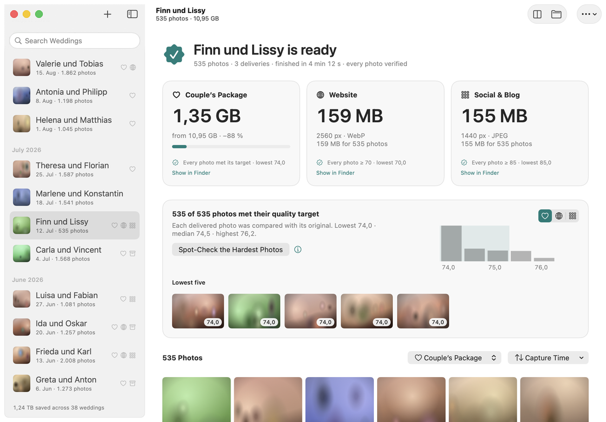 | 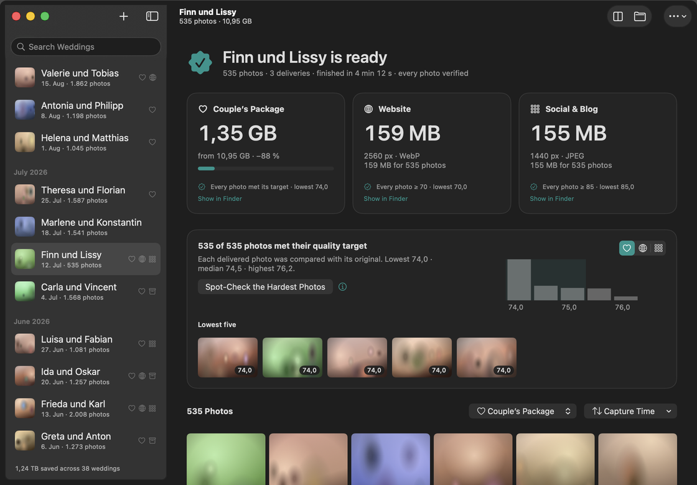 |
| 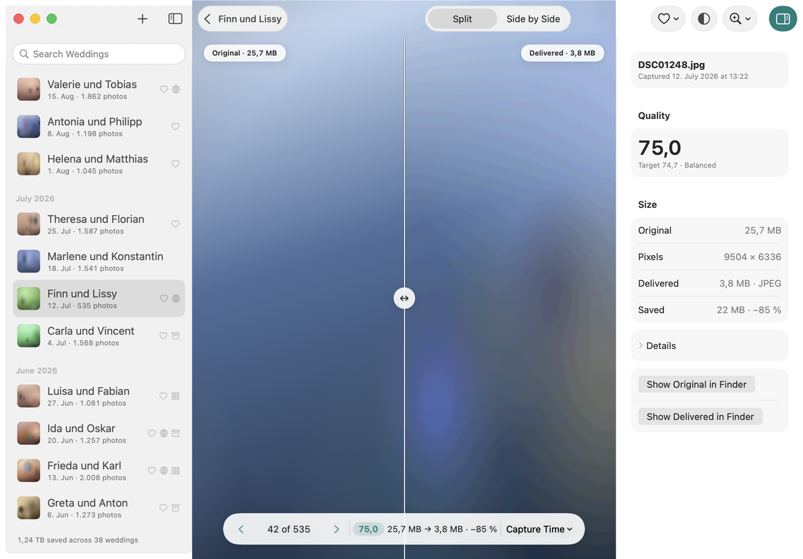 | 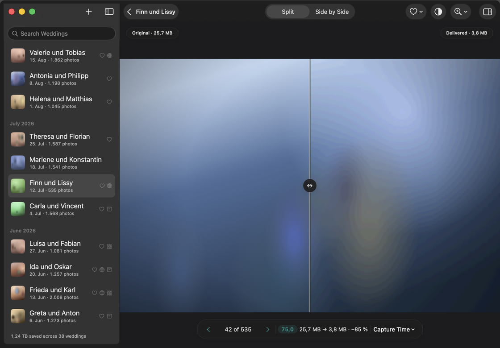 |
| 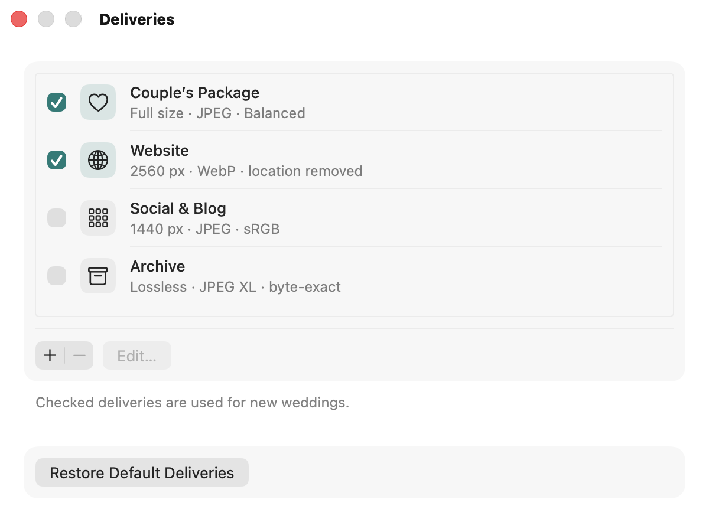 | 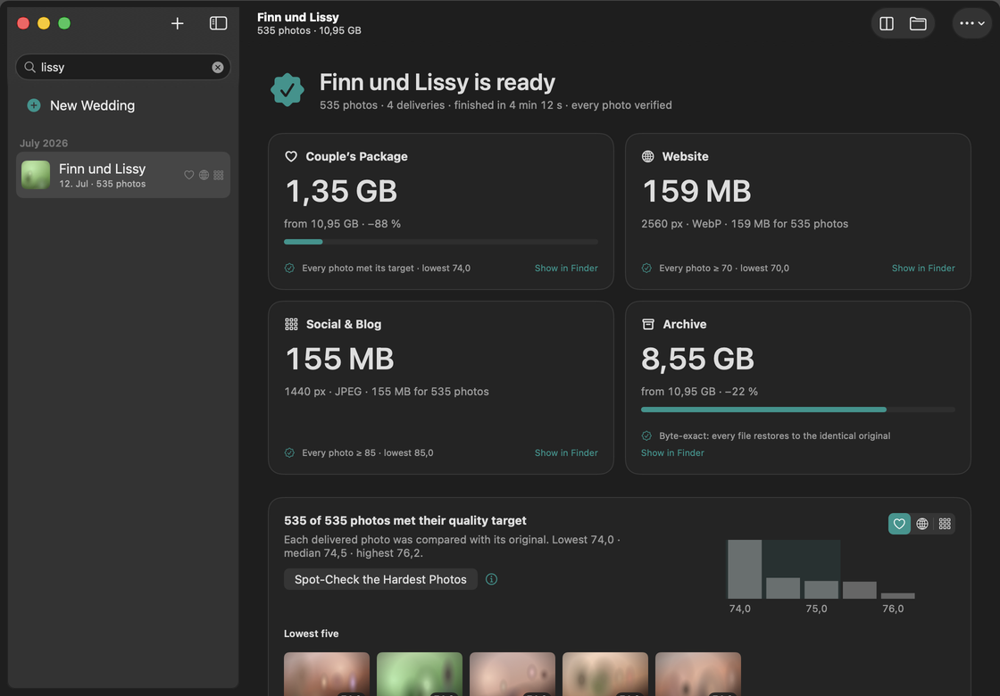 |
| 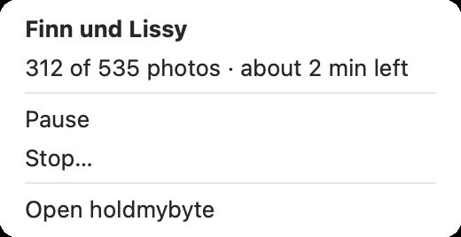 | 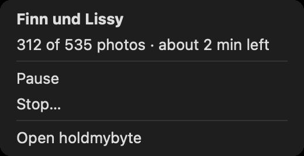 |

## Requirements

- macOS 26 on Apple Silicon, Xcode 26 (Swift 6.2)
- For building the codecs once per machine: `git`, `cmake` and `ninja` (e.g. from Homebrew — used as build tools
  only; nothing from Homebrew is linked)

## Build

```bash
Scripts/build-codecs.sh     # once per machine: libjxl v0.11.2 (+ jpegli) and libwebp v1.6.0 from pinned sources
swift build
swift test
```

`Scripts/build-codecs.sh` clones the pinned tags (verified against the commits in `Vendor/codecs.lock`), builds them
as static libraries, merges them into `Vendor/xcframeworks/HMBCodecs.xcframework` and copies the headers listed in
`Scripts/codec-headers.txt` into `Sources/CHMBCodecs/vendor-include/`. Both outputs are git-ignored. The script
audits the archive (no exported `jpeg_*` symbols, no Homebrew paths) and is a no-op when the output already matches
`OUTPUT_SHA256` in the lock. In a git worktree, clone the main checkout's build instead of rebuilding:

```bash
Scripts/link-codecs.sh ~/Desktop/holdmybyte
```

`Scripts/check-repo.sh` is the repository hygiene gate (no client photos, nothing over 512 KB, no `unsafeFlags`).

Release bundle, icon and audits:

```bash
Scripts/bundle-app.sh            # build/holdmybyte.app (ad hoc signed; hmb in Contents/Helpers); --smoke launches it
Scripts/make-icon.sh build/assets  # asset catalog only: Liquid Glass app icon + AccentColor via actool (Xcode 26)
Scripts/check-repo.sh            # hygiene + network audit of the built binaries
Scripts/notarize.sh              # Developer ID + notarytool (DEVELOPER_ID, NOTARY_PROFILE; owner only)
```

Screenshots of every UI state, rendered offscreen (works with the screen locked):

```bash
Scripts/snapshot.sh --release    # → Snapshots/index.html (see Docs/SNAPSHOTS.md)
```

## Run

```bash
swift run holdmybyte                         # the app: live engine, history in ~/Library/Application Support/holdmybyte
HMB_FIXTURE_ENGINE=1 swift run holdmybyte    # demo: FixtureEngine and a fixture history, all in memory, no files
```

The app keeps its history as one `record.json` per wedding in `~/Library/Application Support/holdmybyte/Weddings`,
presets and settings in its defaults (`holdmybyte.*`), and thumbnails in
`~/Library/Caches/eu.sebastianhaas.holdmybyte/Thumbnails`.

## Layout

| Path | Contents |
|---|---|
| `Sources/HMBModel` | Shared value types, `EngineService`, store protocols, `HMBFormat` |
| `Sources/CHMBCodecs` | Plain C bridge (`hmb_codecs.h`) over jpegli, libwebp and libjxl |
| `Sources/HMBEngine` | Primitives (codecs, imaging, Metal metric), search, pipeline, jobs, `LiveEngine` |
| `Sources/HMBStore` | History JSON, presets, settings, thumbnail cache |
| `Sources/HMBFixtures` | Deterministic domain fixtures, `FixtureEngine`, in-memory stores, synthetic thumbnails |
| `Sources/HMBUI` | SwiftUI views, design tokens, `AppState` / `AppModel` |
| `Sources/HoldMyByteApp` | The app (`holdmybyte`) |
| `Sources/hmb` | The command-line tool (`hmb`) |
| `Sources/HMBSnapshot` | Offscreen snapshot harness (`hmb-snapshot`) |
| `Sources/HMBBench` | Benchmark runner and reports |
| `Tests/Fixtures` | Synthetic test images only (regenerate with `swift Tests/Fixtures/generate.swift`) |

## Local test data (never committed)

Tests and benchmarks that need real photos read them from folders named by environment variables
(`HMB_TEST_PHOTOS`, `HMB_HOLDOUT`, `HMB_WEDDING`, `HMB_OLD_ENGINE`, `HMB_FIXTURE_PHOTOS`; see `Docs/SPEC.md` §5.6).
Without them those tests are skipped. On the development Mac:

```bash
source "$HOME/Library/Application Support/holdmybyte-dev/env.sh"
```

## Benchmarks

`hmb bench` measures holdmybyte on a folder of photos and compares it with the old engine, JPEGmini's numbers and the
v2 gates (`Benchmarks/baselines.json`). `Scripts/bench.sh holdout | wedding-couple | wedding-all | …` runs one gate
set into `Benchmarks/runs/`; results, with the machine state of every timing, are in
[`Docs/BENCHMARKS.md`](Docs/BENCHMARKS.md). Timing gates are only reported on a quiet machine (1-minute load < 3).

## Licence

_To be decided._ Vendored codecs: libjxl (BSD-3-Clause), libwebp (BSD-3-Clause), Highway (Apache-2.0 / BSD-3-Clause),
Brotli (MIT), skcms (BSD-3-Clause).
